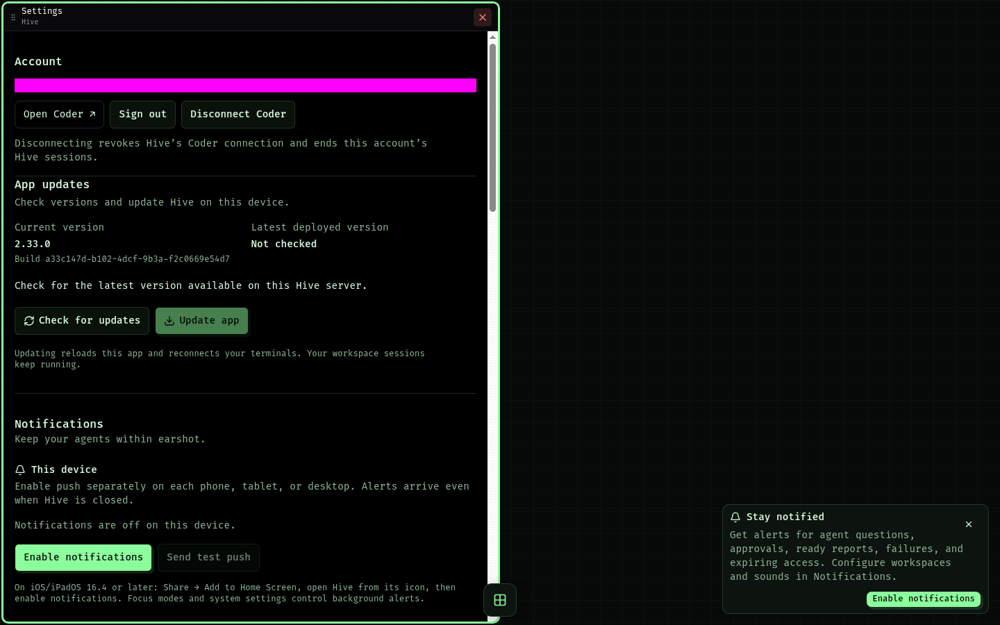
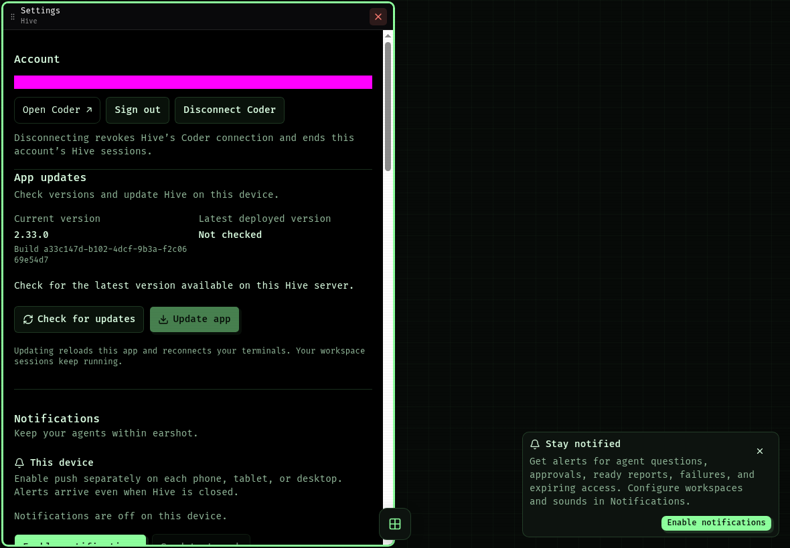

# P02 browser acceptance

The dedicated Codex test account completed Coder password sign-in, official consent, Hive callback, reload, Settings, local sign-out, sign-in, Disconnect Coder and reconnect through the Preview UI.

The accepted final phase ran source `9b1c1f8d44f1490be7e31eb40dcba38ca76ee497`, app build `a33c147d-b102-4dcf-9b3a-f2c0669e54d7`, version `2.33.0`. The earlier consent and disconnect phase ran source `eac11a782c667accffd49f5e9ff33d29ca2a611d`.

- A unique terminal received the fixed PID marker and verified `stty` dimensions of 34 rows and 71 columns. Reload and the UI Reconnect action retained PID 18947. Exact `exit` produced native browser close code 1000 with `wasClean=true`. The window closed, and a read-only check confirmed the exact tmux session and PID were absent.
- Three concurrent credential callers completed after root forced the stored grant expiry. One provider refresh POST occurred. The account returned to idle. Authenticated Settings rendered after the refresh, and final Sign out removed the framework cookie. The subsequent unauthenticated request returned 307 to `/login`.
- The reused Browser workspace and software workspace were retained. The terminal fixture reported `start_error` from optional plugin setup while its build was running and agent connected.

The harness completion-marker check was false. Root's refresh receipt completed at 21:25:42.936 UTC, before the hold ended and the final Settings read and sign-out. The receipt retains that timing distinction.

Preparation attempts exposed an overly restrictive harness guard for Coder's read-only authorization POST and rollout-time missing JavaScript. Fresh navigation loaded the current referenced webpack runtime with HTTP 200 before the accepted phase. Root also corrected the local sign-out cookie-clearing order exposed by the first UI phase.

The JSON receipts contain stage metadata and finite counters. Screenshots mask the account email. Passwords, cookies, tokens and OAuth query values are excluded.

