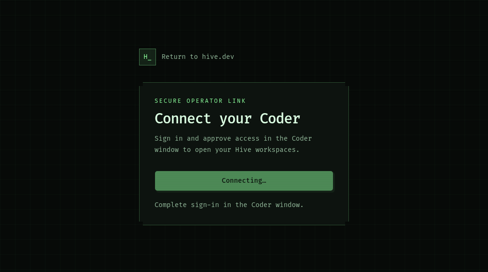
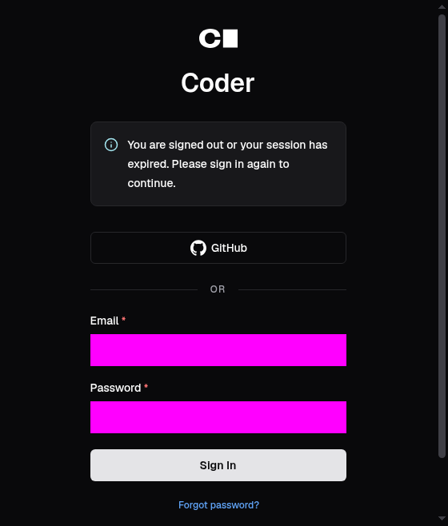

# OAuth popup and Safari navigation follow-up

The owner reported a Safari download prompt after Coder consent and requested a
separate floating sign-in window on 14 November 2026.

## Comparison with the epic

Epic [PR402](https://github.com/kethalia/hive/pull/402), commit `81e5e084`,
corrected sign-in from an immutable preview origin. Its rejected start request
returned an empty 400 response without a content type. The correction used the
registered canonical start origin, readable plaintext responses and `nosniff`.
The original record is
[preserved on the epic](https://github.com/kethalia/hive/blob/codex/delivery-system-design/docs/checks/autonomous-delivery/coder-oauth-preview-alias.md).

The P02 live check on `109224ae` found a successful 302 callback with
`Content-Type: application/json`, `nosniff`, and no attachment header. Headed
Chrome followed it to the authenticated HTML page and recorded zero downloads.
The supplied Safari screenshot shows Coder's authorization-complete page. The
current Safari download cause remains unconfirmed.

The updated callback wrapper explicitly types navigation redirects as
`text/plain; charset=utf-8` with `nosniff`, preserving framework cookies and
Location. JSON sign-in responses retain their media type. Regression checks
cover successful and failed redirects and the framework's existing API responses.

## Popup flow

The Continue button opens a 560-by-720 popup synchronously during the click,
before the asynchronous sign-in request. Coder login and consent happen there.
Hive displays progress in the original window.

Better Auth retains responsibility for PKCE, OAuth state, callback handling,
credentials and session creation. The server accepts an optional validated UUID
to select a fixed internal completion URL. The registered Coder callback remains
`/api/auth/callback/coder`.

The completion page verifies the Hive session, then sends its result to the
original window using an exact target origin. The parent accepts only its own
popup, matching origin and matching attempt UUID. Messages contain a completion
boolean and correlation UUID. The popup closes and the parent opens workspaces.

Blocked popups allocate no OAuth flow and display a retry instruction. Closing
the popup cancels its pending request and restores the button. A ten-minute UI
deadline follows Better Auth's state lifetime. Unmounting releases the popup,
request, event listener and timers. An unavailable opener has a visible return
path in the completion page.

Browsers control the final window presentation. Mobile browsers can present a
tab. The deployed Coder login response currently has no COOP/COEP header.

## Validation

The focused callback, popup, completion-page and existing login tests pass 53
checks. Independent review found no confirmed P1/P2 issue in the new popup flow.
The full suite passes 2,323 tests. Application and Cloudflare typechecks,
formatting, and CI pass for the popup implementation.

The original acceptance used Linux Chrome. The 15 November follow-up below adds
Linux WebKit. Native Safari confirmation requires the owner's browser.

## Hosted popup acceptance

The [live receipt](popup-live-acceptance.json) accepts source
`9486af1aa6c933d96f4e39ac7223127bdd98fb54`, application build
`0f2cd44d-c8af-48ce-9db9-e8b1f0fcbc42`, through connected Workers Build
`ced352ee-e879-4c78-bdd9-ee791035e545` and unique preview `41396aec`.

- A blocked opening starts zero OAuth requests and restores the retry button.
- Closing a real popup restores the original window's sign-in button.
- The real sign-in uses a distinct Chrome window, measured at 560 by 693 pixels.
  The original window stays on Hive login during Coder password entry and consent.
- The real callback returns 302 with plaintext UTF-8 and `nosniff`. Its completion
  document returns HTML with status 200.
- The popup closes automatically. The original window opens workspaces and its
  authenticated application-version request succeeds.
- Chrome records zero downloads. Local sign-out removes the framework cookie.
  The owned browser process and temporary profile are cleaned up.

The [before-fix callback receipt](popup-before-fix-callback.json) retains the
observed JSON media type. One private harness launch variable error was corrected
before the successful test, with its exact owned browser process reconciled.

## Session handoff follow-up on 15 November

The owner reported that Safari stayed on login after consent, including after
closing the popup and refreshing Hive. A read-only preview database check found
a newly committed owner session at 09:03:50 UTC. That establishes server-side
creation. It does not establish that Safari accepted the browser cookie.

Linux WebKit 26.5 through Playwright 1.61.1 successfully completed the previously
deployed `65f9ddd4` flow and rendered the authenticated workspace shell. An early
URL sample still showed `/login`, followed by an authenticated API response and
workspace screenshot. The corrected assessment preserves that timing. This
engine check has not reproduced the owner's persistent native Safari failure.

The updated popup callback returns a self-contained HTML document with the
framework cookies in its HTTP 200 response. It requires no application chunks
or completion-page navigation. Its fixed script sends only the correlation UUID
and completion boolean to the exact Hive origin. The parent closes the popup
after observing a new authenticated browser session.

Before starting consent, the parent records the current session fingerprint.
While pending, it checks a same-origin, private, uncached endpoint every two
seconds. Checks are serialized and bounded. A matching popup message triggers
the same verification. Closing the popup drains any earlier check and performs
a fresh check before reporting cancellation. An unchanged or absent session
cannot complete sign-in. The endpoint hashes the public session UUID and returns
no credentials or user details. A session created in another browser tab can
also satisfy this check because the browser shares authentication cookies.

The full automated suite passes 2,348 tests, with 81 optional skips. Focused
handoff checks pass 76 tests. Both application and Cloudflare typechecks pass.
Hosted acceptance on `c5c66551`, application build
`1a3df0b6-a65c-42a6-b92d-cc517fcba269`, passed four real OAuth flows.
Linux WebKit and Chrome each passed normal completion and recovery with the
completion message suppressed and the popup manually closed after cookie arrival.
All four callbacks returned HTTP 200 HTML with `nosniff`, the parent reached
workspaces with an authenticated API response, and sign-out removed its cookie.
Each flow made one sign-in POST and recorded zero downloads. The
[hosted receipt](session-handoff-live.json) records these checks without credentials.
The original native Safari failure remains unreproduced.

WebKit preparation used private extracted official Debian libraries in Browser
Testing. An installer environment mistake removed two older Chromium caches.
Both exact official revision 1194 caches were restored and recorded. Browser
profiles and system packages were preserved.
