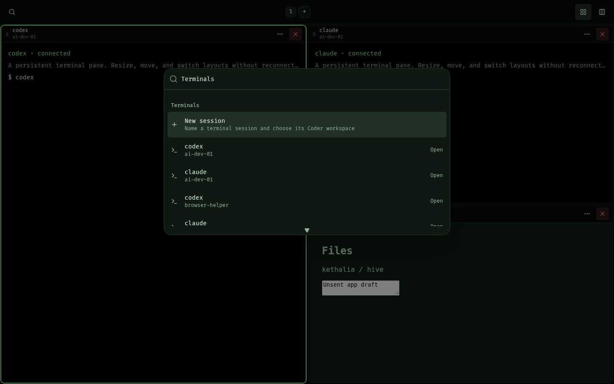
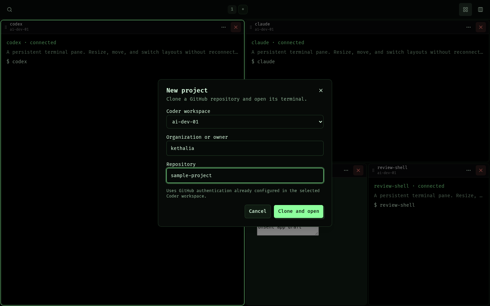
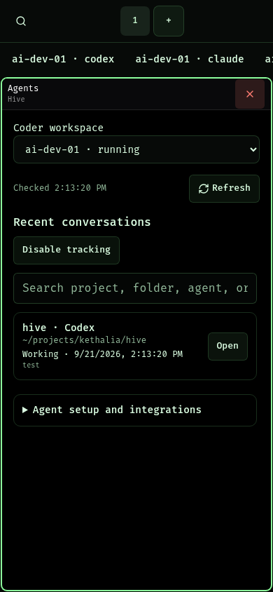

# Workspace launcher validation

Validated on 2026-10-25 using the real React canvas and launcher in Chrome on the
reused `creator-direction-upgrade` Browser Testing workspace. That workspace is
retained because another task uses it. Evidence is preserved here in the primary
repository.

- 36 browser checks pass with no JavaScript page errors; see [report.json](report.json).
- Desktop and mobile: grouped search, named session creation, project creation and
  reuse, iframe focus, native tool windows, agent conversation resume, resize/move,
  saved-layout restoration, no horizontal page overflow, and preserved terminal instances.
- Layout regression coverage includes drag preview/cancel, dividers, Grid/Strip,
  floating windows, stacking/tabs, notifications, wheel gestures, reduced motion,
  and Mac/Windows previous-workspace and close-workspace shortcuts.
- Local validation: 156 Vitest suites / 1,773 tests, targeted focus regressions after
  the final focus adjustment, TypeScript, Biome (six existing non-null assertion
  warnings), and production build with standalone runtime verification.

The fixture mocks authenticated Coder actions and terminal transport. It does not
prove live Coder/PTY or GitHub authentication. Separate action tests cover ownership,
running-workspace checks, clone input validation, and the Python clone command with
a mock GitHub executable, including existing-folder and symlink protection.

To reproduce, build with `node scripts/build-window-management-fixture.mjs <output>`,
copy the output and `e2e/window-management.browser.mjs` to Browser Testing, then run
the browser script there with the output directory argument. Set
`HIVE_PLAYWRIGHT_MODULE` to the workspace's installed Playwright module if needed.
